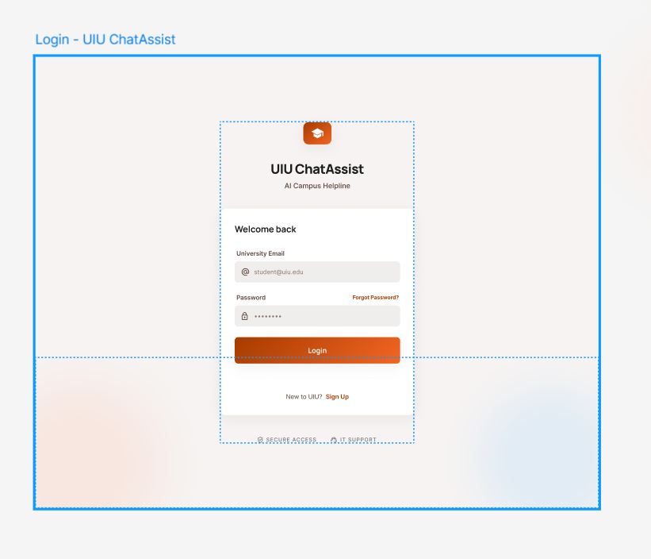
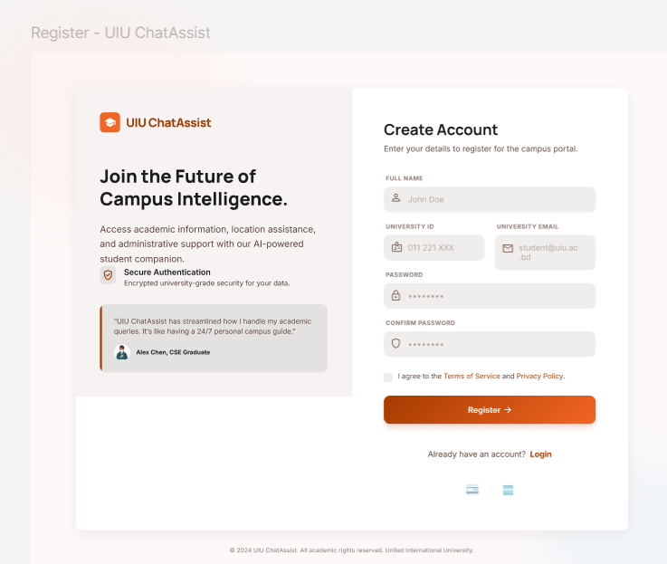
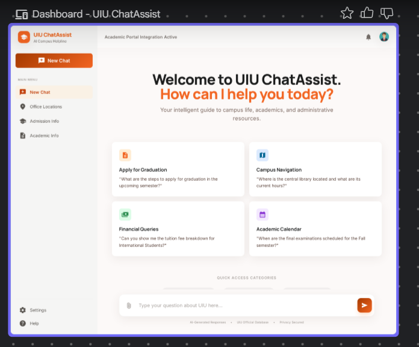

# UIU ChatAssist 🎓🤖
### Intelligent Retrieval-Augmented Generation (RAG) Academic Assistant for United International University

[](https://www.python.org/)
[](https://flask.palletsprojects.com/)
[](https://groq.com/)
[](https://github.com/facebookresearch/faiss)
[](LICENSE)
[]()

---

## 📌 1. Overview

**UIU ChatAssist** is an intelligent, domain-specific AI conversational assistant built specifically for students, faculty, and prospective candidates of **United International University (UIU)**.

By leveraging **Retrieval-Augmented Generation (RAG)**, UIU ChatAssist bridges the gap between static university web portals and natural conversation. It grounds every response in verified, structured data crawled directly from the official UIU Computer Science & Engineering (CSE) academic portal. Users can ask questions regarding faculty profiles, academic curricula, admissions, credit requirements, tuition fees, grading criteria, and university policies, receiving concise, hallucination-free answers within seconds.

---

## 🔍 2. Problem Statement & Motivation

University websites are comprehensive but often complex to navigate:
- **Information Fragmentation:** Critical details (faculty contact info, room numbers, course prerequisites, tuition waiver policies) are distributed across dozens of subpages and nested menus.
- **Search Inefficiencies:** Standard keyword-based portal search engines often return irrelevant PDF notices or broken links without synthesizing an answer.
- **Student Friction:** New and current students frequently spend considerable time locating basic administrative and academic guidance.

**UIU ChatAssist** addresses these challenges by transforming university data into a searchable semantic knowledge base paired with ultra-low latency LLM inference powered by **Groq Cloud**.

---

## 🌟 3. Key Features

- **🔐 Robust User Authentication & Session Security:**
  - Secure registration and login workflows with password hashing (`scrypt` via Werkzeug).
  - Validation of UIU Student ID and Department.
  - Session-based conversation isolation ensuring privacy between users.

- **🧠 Domain-Grounded Conversational RAG:**
  - Semantic vector search using Facebook AI Similarity Search (**FAISS**) and dense embeddings (**Sentence-Transformers** `all-MiniLM-L6-v2`).
  - High-speed, high-reasoning LLM inference via **Groq Cloud** running `openai/gpt-oss-120b`.
  - Grounded prompt engineering enforcing factual accuracy, preventing hallucinations, and formatting concise, student-friendly responses (80–150 words).

- **💬 Multi-Turn Conversation Memory:**
  - Persists dialog context across turns within active threads.
  - Automatically loads and formats prior messages to support intuitive follow-up questions.

- **🗂️ Thread Management & Conversation History:**
  - Persistent chat history backed by SQLite (`users.db`).
  - Create new chat sessions, resume previous discussions, and securely delete conversation threads.

- **🎨 Modern, Responsive Student UI:**
  - Frosted glass aesthetic with authentic blurred UIU campus background backdrop.
  - Dynamic chat view: auto-collapsing welcome screen upon query submission.
  - Real-time animated typing indicator (`#loadingSpinner`).
  - Interactive profile dropdown displaying student name, UIU ID, email, and live portal health.
  - Fully responsive across desktop, tablet, and mobile displays.

- **🏥 Live System Health Monitoring:**
  - `/health` endpoint actively monitors vector index status, database connectivity, and Groq API readiness.

---

## 🏗️ 4. System Architecture & RAG Pipeline

```
                                   +--------------------------+
                                   |   UIU CSE Web Portal     |
                                   |  (https://cse.uiu.ac.bd) |
                                   +-------------+------------+
                                                 |
                                         Scrapy Spider (crawl.py)
                                                 |
                                                 v
                                   +-------------+------------+
                                   |  data/raw/               |
                                   |  cse_full_data.json      |
                                   +-------------+------------+
                                                 |
                                         Chunking (chunk.py)
                                                 |
                                                 v
                                   +-------------+------------+
                                   |  data/chunks/            |
                                   |  chunks.json             |
                                   +-------------+------------+
                                                 |
                         SentenceTransformer ("all-MiniLM-L6-v2") (embedding.py)
                                                 |
                                                 v
                                   +-------------+------------+
                                   |  data/embeddings/        |
                                   |  embeddings.npy + meta   |
                                   +-------------+------------+
                                                 |
                                         FAISS Indexing (vector_db.py)
                                                 |
                                                 v
                                   +--------------------------+
                                   |  data/vector_store/      |
                                   |  faiss_index.index       |
                                   +-------------+------------+
                                                 |
================================ RUNTIME INFERENCE FLOW ================================
                                                 |
[ User Query ]  ──►  Flask App (app.py)          |
                           │                     |
                           ▼                     |
             Encode Query with MiniLM-L6-v2      |
                           │                     |
                           ▼                     |
            FAISS Top-K Vector Search ◄──────────┘
                           │
                           ▼
          Retrieve Relevant Context Chunks + Conversation History
                           │
                           ▼
           Construct Grounded System & User Prompt
                           │
                           ▼
                Groq API (openai/gpt-oss-120b)
                           │
                           ▼
          Concise, Factual Academic Answer ──► [ User Interface ]
```

---

## 💻 5. Tech Stack

| Component | Technology | Description |
| :--- | :--- | :--- |
| **Backend Framework** | **Flask 3.0+** | Lightweight Python WSGI web framework for routing & APIs |
| **LLM Inference** | **Groq Cloud API** | Ultra-fast inference running `openai/gpt-oss-120b` |
| **Vector Search** | **FAISS (CPU)** | High-efficiency similarity search & dense vector clustering |
| **Embedding Model** | **Sentence-Transformers** | `all-MiniLM-L6-v2` (384-dimensional dense semantic vectors) |
| **Database** | **SQLite3** | Relational storage for users, threads, and chat messages |
| **Web Scraping** | **Scrapy 2.11+** | Asynchronous crawler for UIU department pages and structure |
| **Security** | **Werkzeug Security** | Secure password hashing (`scrypt`) and session auth |
| **Frontend** | **HTML5 / CSS3 / Vanilla JS** | Custom responsive UI, CSS grid/flexbox, Font Awesome icons |

---

## 📁 6. Project Directory Structure

```plaintext
UIUChatAssist/
├── data/                               # Core RAG data assets
│   ├── raw/
│   │   └── cse_full_data.json          # Scraped university web content
│   ├── chunks/
│   │   └── chunks.json                 # Preprocessed, overlapping text segments
│   ├── embeddings/
│   │   ├── embeddings.npy              # Serialized 384-d vector embeddings
│   │   └── metadata.json               # Chunk source titles, URLs, and mapping
│   └── vector_store/
│       └── faiss_index.index           # Serialized FAISS IndexFlatIP vector database
├── scrapers/                           # University web scraping suite
│   ├── scrapy.cfg                      # Scrapy deployment configuration
│   └── uiu_cse/                        # Scrapy spider package
│       ├── items.py                    # Scraped data models
│       ├── pipelines.py                # Pipeline formatting and output writer
│       ├── settings.py                 # Crawler concurrency and delay policies
│       └── spiders/
│           └── cse_spider.py           # Spider traversing UIU CSE portal
├── static/                             # Frontend assets
│   ├── css/
│   │   ├── chat.css                    # Chat interface styling and animations
│   │   ├── register.css                # Registration portal styling
│   │   └── style.css                   # Login page & blurred background styling
│   ├── images/
│   │   ├── uiu.jpg                     # Authentic UIU campus photograph
│   │   ├── login.png                   # UI showcase: Login page
│   │   ├── chatpage.png                # UI showcase: Chat assistant
│   │   └── Registration_page.png       # UI showcase: Registration page
│   └── script.js                       # Asynchronous chat logic, DOM updates & modals
├── templates/                          # Jinja2 HTML templates
│   ├── login.html                      # Student portal login view
│   ├── register.html                   # Account registration view
│   └── chat.html                       # Core conversational chat interface
├── .env.example                        # Safe environment variables template
├── .gitignore                          # Comprehensive security and build ignore rules
├── app.py                              # Flask application, auth, RAG logic & endpoints
├── chunk.py                            # Document parsing and chunk generation script
├── crawl.py                            # Scrapy runner and crawler entry point
├── embedding.py                        # Vector generation using Sentence-Transformers
├── requirements.txt                    # Project dependencies
├── search.py                           # CLI retrieval testing tool
├── vector_db.py                        # FAISS index builder script
└── VERSION                             # Application version tracking
```

---

## ⚙️ 7. Prerequisites

Before setting up UIU ChatAssist, ensure you have:

- **Operating System:** Windows 10/11, macOS, or Linux.
- **Python:** Python `3.10`, `3.11`, or `3.12` installed (ensure `python --version` is accessible from terminal).
- **Git:** Installed on your workstation.
- **Groq API Key:** A free API key obtained from [Groq Cloud Console](https://console.groq.com/keys).

---

## 🚀 8. Step-by-Step Installation & Setup Guide

### 1. Clone the Repository
```bash
git clone https://github.com/your-username/UIUChatAssist.git
cd UIUChatAssist
```

### 2. Create and Activate a Virtual Environment

**On Windows (PowerShell):**
```powershell
python -m venv .venv
.\.venv\Scripts\Activate.ps1
```

> *Note: If PowerShell displays an execution policy restriction, run:*  
> `Set-ExecutionPolicy -ExecutionPolicy RemoteSigned -Scope CurrentUser`

**On macOS / Linux (Bash/Zsh):**
```bash
python3 -m venv .venv
source .venv/bin/activate
```

### 3. Install Required Dependencies
```bash
pip install --upgrade pip
pip install -r requirements.txt
```

---

## 🔑 9. Environment Variables Configuration

Copy the `.env.example` template to create your local `.env` file:

**On Windows (PowerShell):**
```powershell
Copy-Item .env.example .env
```

**On Linux / macOS:**
```bash
cp .env.example .env
```

Open `.env` in your preferred editor and configure your credentials:

```ini
# ========================================================
# UIU ChatAssist - Environment Variables
# ========================================================

# Your Groq API Key from https://console.groq.com/keys
GROQ_API_KEY=gsk_your_actual_groq_api_key_here

# Flask Session Security Key (random string)
SECRET_KEY=generate_a_random_secret_key_here
```

> 💡 **Tip:** Generate a secure random `SECRET_KEY` in terminal via:
> ```bash
> python -c "import secrets; print(secrets.token_hex(24))"
> ```

---

## ▶️ 10. Running the Application Locally

Start the local Flask development server:

```bash
python app.py
```

You should see output similar to:
```plaintext
 * Serving Flask app 'app'
 * Debug mode: on
 * Running on http://127.0.0.1:5000
```

1. Open your web browser and navigate to: **`http://127.0.0.1:5000`**
2. Click **"Don't have an account? Sign up"** to create a student account (e.g., UIU Student ID `011211000`).
3. Log in with your credentials to access the chat interface.
4. Try asking sample questions:
   - *"Who is the head of the CSE department at UIU?"*
   - *"What are the admission requirements for undergraduate CSE?"*
   - *"How does the tuition fee waiver policy work?"*
   - *"Where is Dr. Swakkhar Shatabdi's office located?"*

---

## 🔄 11. Rebuilding the RAG Pipeline (Optional)

The repository comes pre-packaged with indexed data in `data/`, allowing you to run the chatbot immediately without crawling. If you wish to refresh the university data or adapt the project for another department, run the pipeline scripts in sequence:

```bash
# 1. Crawl the UIU CSE website (extracts raw text into data/raw/)
python crawl.py

# 2. Chunk the raw data into semantically overlapping segments
python chunk.py

# 3. Generate 384-dimensional dense embeddings
python embedding.py

# 4. Construct the serialized FAISS vector index
python vector_db.py

# 5. (Optional) Test retrieval accuracy directly in terminal
python search.py
```

---

## 📸 12. Screenshots & UI Walkthrough

### Student Login Portal
*Authentic UIU campus photograph with an 8px blur layer, sharp login card, and responsive layout.*


### Student Registration
*Account creation with UIU Student ID, Department selection, and terms acknowledgment.*


### Chat Assistant Interface
*Conversational interface featuring session history, quick query suggestions, and grounded responses.*


---

## ⚠️ 13. Limitations & Roadmap

### Current Limitations
- **Departmental Scope:** The current RAG vector dataset is primarily indexed on UIU's Computer Science & Engineering (CSE) portal.
- **Static Ingestion:** Dynamic portal updates (daily notice boards) require re-running the crawler pipeline.
- **API Dependency:** Generation relies on Groq API connectivity and free-tier rate limits.

### Planned Roadmap
- [ ] Multi-department crawling (BBA, EEE, Pharmacy, Civil Engineering).
- [ ] OCR ingestion pipeline for scanned PDF notices and academic calendars.
- [ ] Multi-lingual support (Bengali / English bilingual queries).
- [ ] Automated scheduled scraping using GitHub Actions / background crons.
- [ ] Export conversation transcripts (PDF/Markdown export).

---

## 📄 14. License

This project is licensed under the **MIT License** — see the [LICENSE](LICENSE) file for details.

---

## 👨‍💻 15. Author & Acknowledgments

- **Developer:** [Your Name / Portfolio Link](https://github.com/your-username)
- **Institution:** United International University (UIU), Dhaka, Bangladesh
- **Department:** Department of Computer Science & Engineering (CSE)

---

> ### ⚖️ Disclaimer
> **UIU ChatAssist** is an independent student academic project developed for research, portfolio, and educational purposes. It is **not** an official administrative portal of United International University. All university logos, names, and source materials belong to their respective copyright holders.

